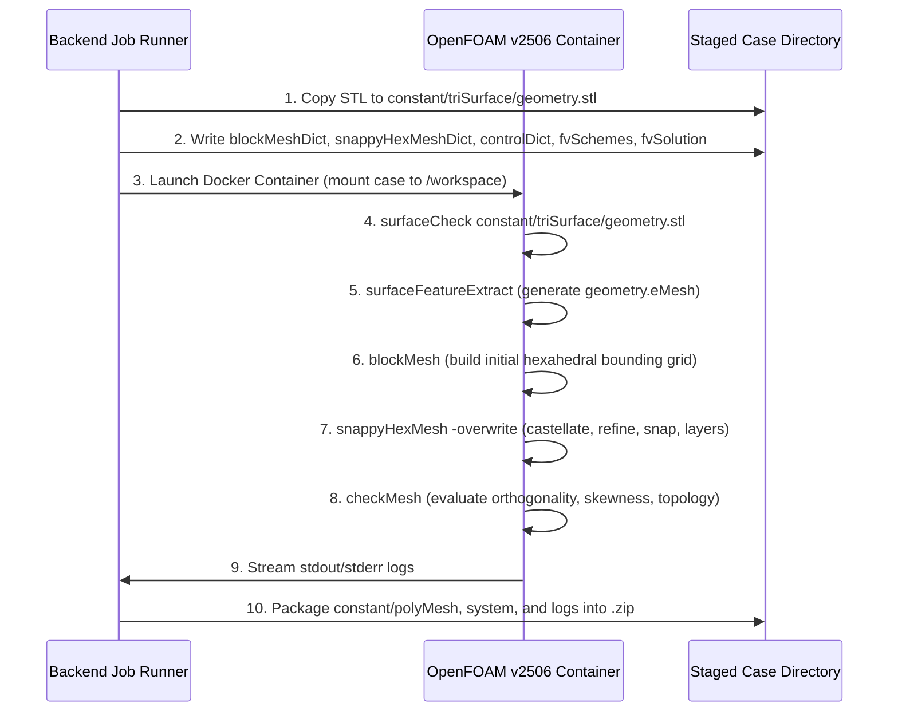

# OpenFOAM Meshing Pipeline & Dictionary Architecture

This document details the exact sequence of OpenFOAM v2506 utilities, dictionary structures, mathematical bounding formulas, and CFD design considerations used in the automated pipeline.

---

## 1. Automated Execution Sequence

When a meshing job is dispatched, the backend stages the case directory and executes the following deterministic sequence:



---

## 2. Geometry Bounding Box & Domain Calculation

Given an STL vertex set \(V = \{(x_i, y_i, z_i)\}_{i=1}^N\), coordinates are computed component-wise:

\[
x_{\min} = \min_i(x_i), \quad x_{\max} = \max_i(x_i), \quad \Delta x = x_{\max} - x_{\min}
\]
\[
y_{\min} = \min_i(y_i), \quad y_{\max} = \max_i(y_i), \quad \Delta y = y_{\max} - y_{\min}
\]
\[
z_{\min} = \min_i(z_i), \quad z_{\max} = \max_i(z_i), \quad \Delta z = z_{\max} - z_{\min}
\]

### Workflow Domain Modes:

### A. External-Flow Domain (`external_flow`)
Models an aerodynamic wind tunnel or atmospheric flow around a vehicle, wing, or building.
- **Upstream Margin** \((-X)\): Default \(1.5 \times \Delta x\) to allow undisturbed inlet profile development.
- **Downstream Wake Margin** \((+X)\): Default \(3.0 \times \Delta x\) to capture flow separation, recirculation, and wake shedding.
- **Lateral Margins** \((\pm Y)\): Default \(1.5 \times \Delta y\) to minimize side wall boundary effects.
- **Vertical Margins** \((\pm Z)\): Default \(1.5 \times \Delta z\) (or floor/ground patch).
- **Keep-Point (`locationInMesh`)**: Placed in the outer fluid domain:
  \[
  P_{\text{keep}} = \left(x_{\min} - 0.4 \times \Delta x \times M_{x,\min}, \quad y_{\min} + 0.5 \times \Delta y, \quad z_{\min} + 0.5 \times \Delta z\right)
  \]

### B. Generic Surface-Conforming Mesh (`generic_surface`)
Generates a symmetrical bounding box around the STL geometry with uniform margins. Suitable for general geometric feature analysis.

### C. Internal-Flow Domain (`internal_flow`)
Used for pipes, manifolds, valve bodies, and interior cavities.
- **Important CFD Consideration**: A closed CAD STL represents the solid walls. The fluid domain is the *cavity inside*.
- **Keep-Point**: Must reside inside the interior fluid cavity:
  \[
  P_{\text{keep}} = \left(\frac{x_{\min} + x_{\max}}{2}, \quad \frac{y_{\min} + y_{\max}}{2}, \quad \frac{z_{\min} + z_{\max}}{2}\right)
  \]
- **Watertight Requirement**: The STL must be completely watertight. Any gap or non-manifold edge will allow the background mesh to leak outside the body.

---

## 3. Generated OpenFOAM Dictionaries

### A. `system/blockMeshDict`
Defines the background hexahedral block:
- Standard outward-pointing face definitions:
  - `inlet`: `(0 4 7 3)` \((-X)\)
  - `outlet`: `(1 2 6 5)` \((+X)\)
  - `bottom`: `(0 1 5 4)` \((-Y)\)
  - `top`: `(3 7 6 2)` \((+Y)\)
  - `front`: `(0 3 2 1)` \((-Z)\)
  - `back`: `(4 5 6 7)` \((+Z)\)
- Background cell division: `(cells_x cells_y cells_z)` with `simpleGrading (1 1 1)`.

### B. `system/surfaceFeatureExtractDict`
Extracts sharp edges into `.eMesh` format using `extractFromSurface`:
```openfoam
geometry.stl
{
    extractionMethod    extractFromSurface;
    includedAngle       150;
    subsetFeatures
    {
        nonManifoldEdges   no;
        openEdges          yes;
    }
    writeObj            yes;
}
```

### C. `system/snappyHexMeshDict`
Controls the 3-stage meshing algorithm:
1. **Castellation (`castellatedMesh true`)**: Subdivides cells intersecting the surface up to `(minSurfaceLevel maxSurfaceLevel)` and keeps cells connected to `locationInMesh`.
2. **Snapping (`snap true`)**: Displaces vertices to conform smoothly to triangular facets and sharp feature edges.
3. **Layer Addition (`addLayers false|true`)**: Extrudes prismatic boundary layers near the geometry wall if enabled.

### D. `system/meshQualityDict`
Enforces geometric mesh health:
- `maxNonOrtho 65;` (Limits maximum non-orthogonality angle)
- `maxBoundarySkewness 4;`
- `maxInternalSkewness 4;`
- `minTetQuality 1e-15;`

---

## 4. Understanding `checkMesh` Output

OpenFOAM's `checkMesh` validates whether the final grid is suitable for numerical solving:
- **Topology**: Checks boundary definitions, cell-to-face addressing, and point usage. Reports `Number of regions: 1 (OK)`.
- **Non-Orthogonality**: Measures the angle between the face normal vector and the vector connecting cell centers.
  - \(\le 70^\circ\): Excellent. Solves cleanly.
  - \(70^\circ - 85^\circ\): Acceptable, but requires `nNonOrthogonalCorrectors` in `system/fvSolution`.
  - \(> 85^\circ\): Severe non-orthogonality. Risk of divergence.
- **Skewness**: Distance between face center and line connecting cell centers.
  - \(\le 4.0\): Standard acceptable threshold.
- **Result Status**:
  - `Mesh OK.`: Fully valid topological and geometric mesh.
